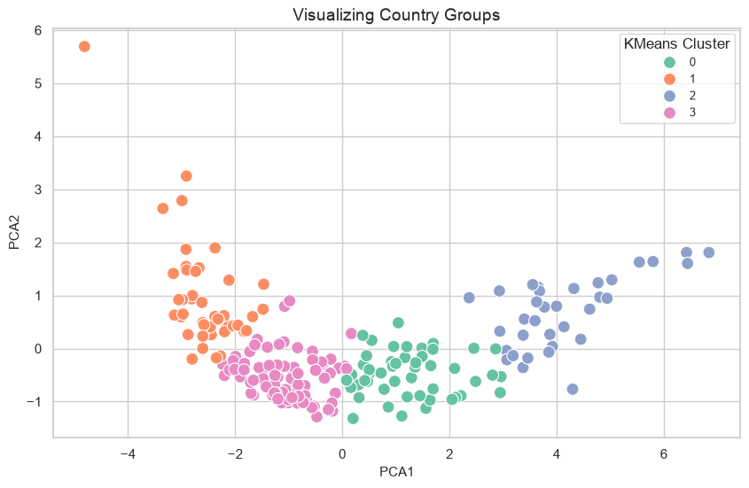
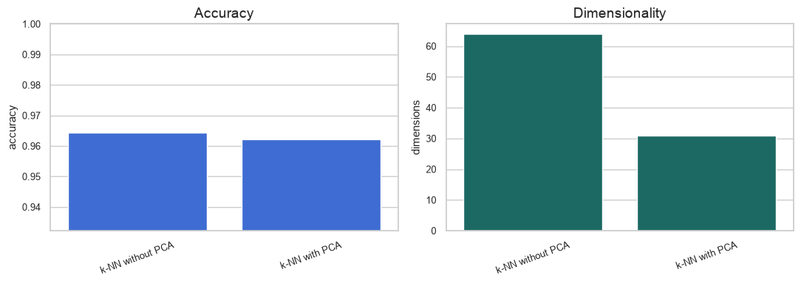

# Yves Abdallah — Data Science & AI Portfolio

Selected projects in data science, artificial intelligence, and analytics from my hybrid Big Data, AI, and Management degree at Centrale Nantes and Audencia Business School.

The portfolio includes practical work in Python, R, machine learning, natural language processing, dimensionality reduction, clustering, and data cleaning.

## How to read this portfolio

Each project link opens a short project page with the objective, data, methods, difficulty, results, limitations, and reproduction steps. The project folder also contains the notebook, script, dataset, or charts used for the work.

## Projects

### 1. Financial News Sentiment Classification

<small><strong>Advanced NLP project.</strong> Classifies 5,842 financial-news sentences with TF-IDF models, a Bi-LSTM, and FinBERT. Includes model comparison and class-imbalance analysis.</small>

[View the project page — methods, model scores, dataset, and notebook](python/financial-sentiment-analysis/)

### 2. Machine Learning Model Comparison

<small><strong>Advanced machine-learning lab.</strong> Compares regression, Random Forest, and XGBoost using cross-validation, ROC/AUC, threshold tuning, and hyperparameter search.</small>

[View the project page — models, evaluation methods, limits, and notebook](python/machine-learning-model-comparison/)

### 3. Country Development Clustering

<small><strong>Real-data clustering project.</strong> Groups 211 countries using eight World Bank indicators and compares K-means with hierarchical clustering.</small>

[View the project page — data source, clustering method, charts, and limitations](python/country-clustering/)

### 4. PCA and Handwritten Digit Recognition

<small><strong>Dimensionality-reduction project.</strong> Uses PCA to reduce 64 features to 31 while preserving nearly the same digit-recognition accuracy.</small>

[View the project page — PCA method, accuracy comparison, charts, and notebook](python/pca-and-digit-recognition/)

### 5. Air Pollution Data Cleaning in R

<small><strong>R data-quality project.</strong> Cleans and summarizes 18,980 air-monitoring records from seven Chinese cities, including missing-data checks and PM2.5 analysis.</small>

[View the project page — cleaning steps, dataset, R script, and analysis](r/pollution-analysis/)

### 6. Colon Cancer Classification

<small><strong>Educational classification project.</strong> Applies logistic regression, preprocessing, ROC/AUC evaluation, coefficient interpretation, and feature selection to gene-expression data.</small>

[View the project page — classification workflow, evaluation charts, and notebook](python/colon-cancer-classification/)

## Supporting material

- [Read the machine-learning course report — detailed methodology and results](reports/machine-learning-course-report.pdf)
- [Browse project screenshots — visual previews of the analyses](screenshots/)
