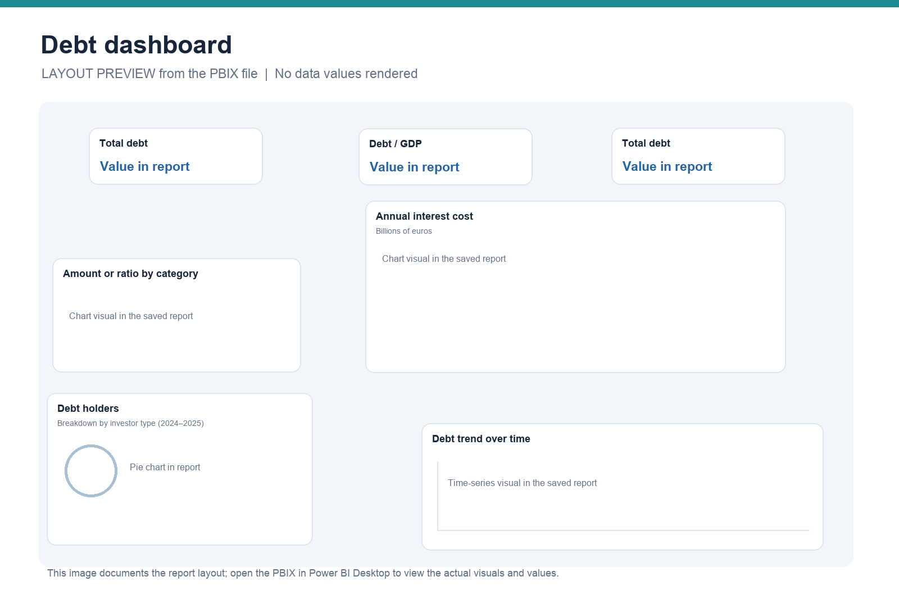

# Debt dashboard

Open [`debt-dashboard.pbix`](debt-dashboard.pbix) in Power BI Desktop.

The populated report page includes cards for total debt and debt as a share of GDP, a debt trend over time, a category comparison, a debt-holder breakdown labelled 2024–2025, and a chart of annual debt interest costs in billions of euros. A second report page is blank in the saved file.

The image above is a layout preview reconstructed from the PBIX metadata, not a screenshot of the live dashboard. The report file contains an embedded data model. The underlying source and geographic scope are not documented in the files available here, so this description does not assign the figures to a particular country or claim a verified data source.
