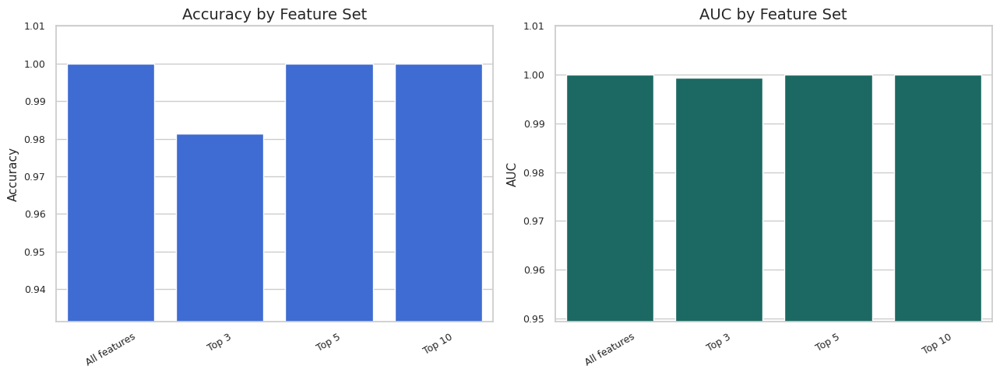
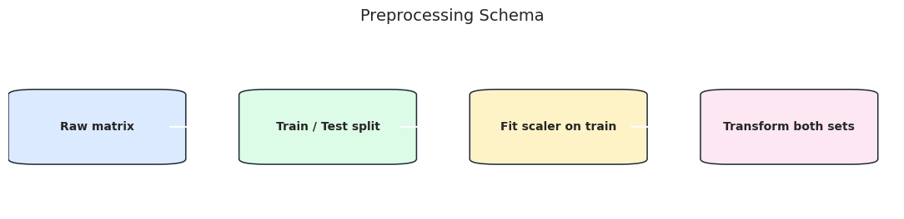
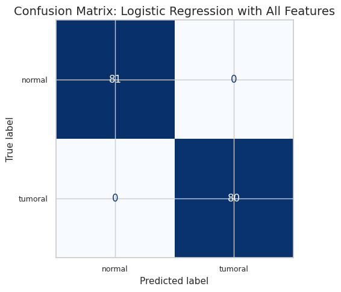

# Cancer Classification and Feature Selection

[Open the notebook](cancer-classification.ipynb).

This saved analysis uses logistic regression to classify tissue samples from gene-expression features. It includes exploratory analysis, a stratified train/test split, training-set scaling, coefficient-based feature selection, and comparisons using all features and smaller feature subsets.

## Current status

The original `colon_cancer.csv` input is missing from the available files. The notebook retains its original saved outputs and these previews were extracted from those outputs. It has not been rerun during portfolio preparation, and the reported near-perfect scores have not been independently verified. Add the original dataset and confirm its source before using this project as a featured result.

To rerun, place `colon_cancer.csv` beside the notebook, install the Python dependencies, and run every cell in order. Dataset provenance and evaluation limits should be documented before public release.

## What the analysis is trying to answer

The notebook asks whether a logistic-regression model can distinguish two tissue classes from gene-expression measurements, and whether a smaller selection of features can retain similar predictive performance. This is a dataset analysis, not a clinical diagnostic tool.

### How it works

The analysis inspects missing values, duplicates, class balance, and feature relationships. It then splits the data, fits the scaler on the training set, trains a classifier, and uses the fitted coefficients to rank features. Models using smaller feature subsets are compared with the full-feature model.

**How to read this diagram:** follow the steps from the raw data through the train/test split to scaling and prediction. Learning preprocessing from training data is important because the test set should remain an independent check.

**How to read this chart:** the diagonal contains correct predictions and the other cells contain mistakes. These are the original saved results. Because the CSV is missing, the numbers cannot currently be reproduced from the repository alone.

**How to read this chart:** the curve shows the trade-off between detecting positive samples and incorrectly flagging negative samples as the probability threshold changes. A high AUC describes this saved test split; it does not establish performance on a different dataset.

### What makes this challenging

**Difficulty: intermediate, with important evaluation requirements.** Gene-expression features may be correlated, and feature selection can make results look overly strong if evaluation is handled incorrectly. Near-perfect saved scores deserve careful checking of the dataset, the split, and possible leakage. The immediate next step is to recover the original CSV and its source, rerun the full notebook, and check that the conclusions hold.
