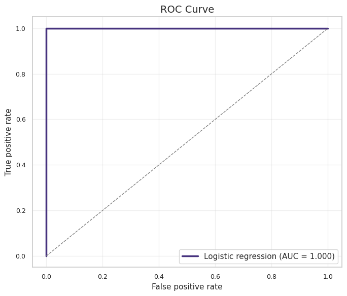

# Colon Cancer Classification with Logistic Regression

An educational machine-learning project using gene-expression measurements to classify tissue samples as **normal** or **tumoral**.

## What I did

1. Inspected the dataset, target balance, missing values, and feature distributions.
2. Split the data into a stratified training and test set.
3. Standardized the gene-expression variables and trained logistic regression.
4. Evaluated the model with accuracy, a confusion matrix, ROC curve, and AUC.
5. Ranked genes by the absolute size and direction of their standardized coefficients.
6. Retrained models with the top 3, 5, and 10 genes to study the performance-versus-complexity trade-off.

## Main result

The notebook shows that a compact feature set can retain very strong predictive performance on this fixed educational dataset. The important lesson is the workflow: use a reproducible split, fit scaling on training data only, compare reduced models, and interpret the coefficients instead of reporting accuracy alone.

## Difficulty and what it demonstrates

**Difficulty: intermediate.** The challenging parts were handling a high-dimensional gene-expression table, avoiding leakage during scaling, interpreting signed coefficients, and comparing models with different numbers of features.

This project demonstrates Python, pandas, NumPy, matplotlib, seaborn, scikit-learn, classification, feature selection, model evaluation, and data storytelling. It is a course project for learning and is not a clinical diagnostic system.

## Reproduce it

Open [the notebook](colon-cancer-logistic-regression.ipynb) in Colab or Jupyter. The original dataset is not included in this public repository. When prompted, upload a file named `colon_cancer.csv` (semicolon-separated) containing the columns used by the notebook, including `tissue_status`.

The notebook contains saved outputs from the original run so the analysis can still be reviewed without the source data. The full written report is available in [reports/practical-sessions-report.pdf](../../reports/practical-sessions-report.pdf).
