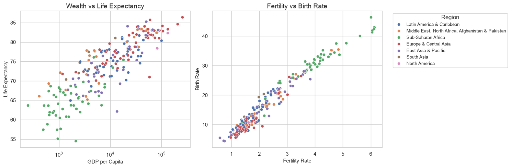
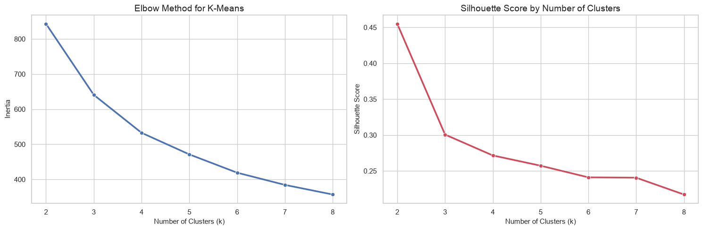
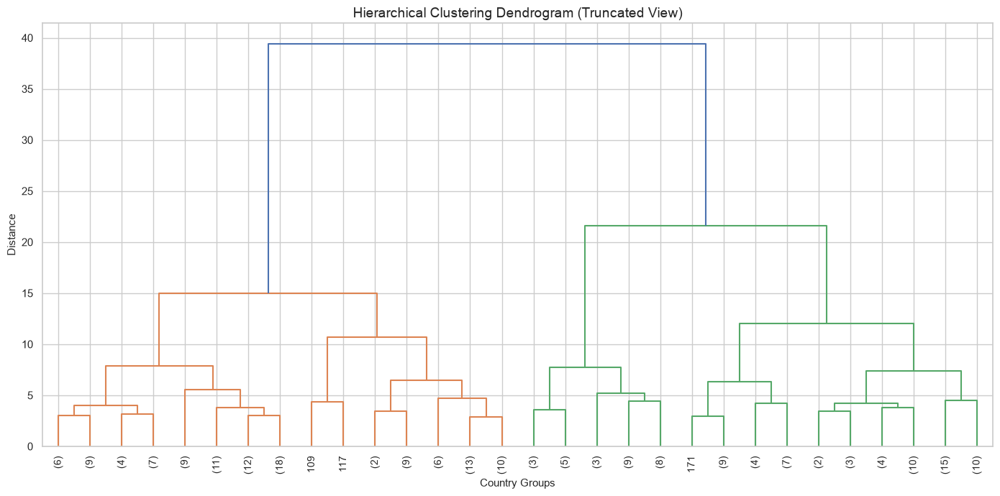

# Country Development Clustering

[Notebook](country-clustering.ipynb)

Which countries have similar demographic, economic, and social profiles? This analysis compares eight World Bank indicators: birth rate, fertility, literacy, female secondary enrollment, GDP per capita, life expectancy, internet usage, and urban population.

## Method

Use the latest observations available within 2010–2023, retain countries with at least six indicators, and fill remaining gaps with medians. Standardize the features so different units are comparable, then apply K-means and Ward hierarchical clustering.

Each point is a country. PCA compresses the eight indicators into two axes; colors show the K-means groups.

These plots explore relationships between individual indicators before interpreting the groups.

## Results and main challenge

The analysis retains **211 countries**. With four groups, silhouette scores are **0.272 for K-means** and **0.240 for hierarchical clustering**; higher scores indicate better separation.

Choosing the group count is the main challenge: two groups score higher, while four show more detailed profiles. Four is therefore an exploratory choice, not a definitive classification.

Left: within-group variation falls as groups are added. Right: silhouette scores help compare separation.

Taller joins indicate larger differences between merged groups. The tree is shortened for readability.

## Limits

Observation years vary, and filling missing values affects the groups. This describes patterns, not causes or a ranking of countries. World Bank revisions can change later results.

**Source:** [World Bank Indicators API](https://api.worldbank.org/v2/country/all/indicator/NY.GDP.PCAP.CD?format=json&date=2010:2023&per_page=20000).

**To reproduce:** install [requirements.txt](../requirements.txt) and run the notebook in order with internet access.
