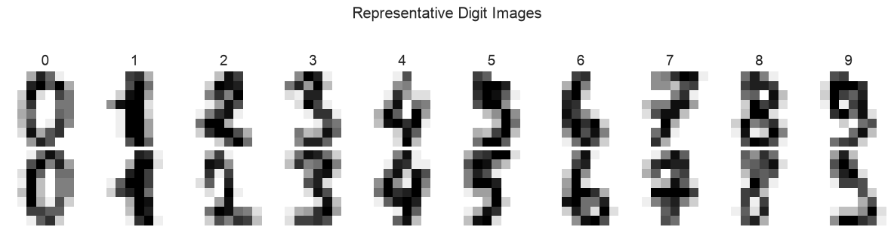
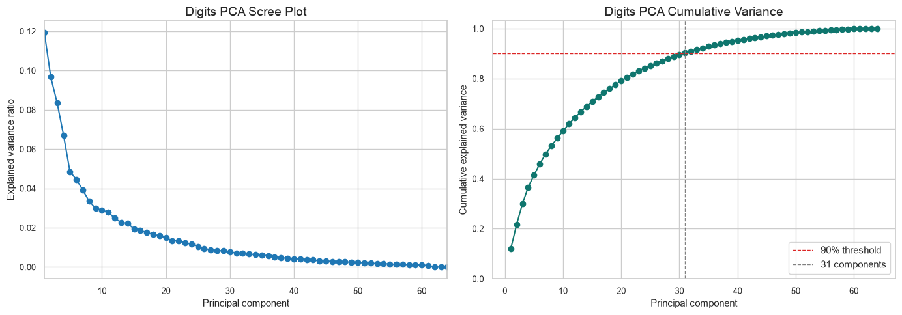
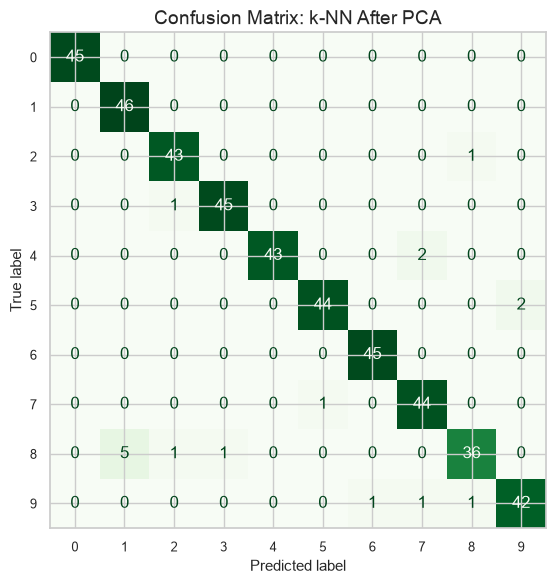
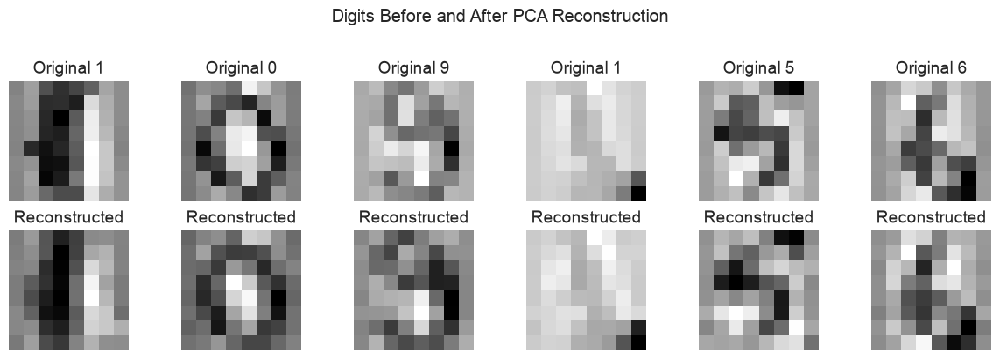

# PCA and Handwritten Digit Recognition

[Open the notebook](pca-and-digit-recognition.ipynb).

This project compares a five-neighbor k-NN classifier using 64 pixel features with the same classifier after principal component analysis. It uses scikit-learn's built-in handwritten-digits dataset and a stratified 75% training / 25% test split with a fixed random seed. Scaling and model PCA are fitted on training data only.

| Model | Features | Test accuracy |
| --- | ---: | ---: |
| k-NN with original features | 64 | 96.44% |
| k-NN after PCA | 31 | 96.22% |

The reduced representation retained about 90.25% of the training variance. These figures describe one held-out split of this dataset; they are not a general performance guarantee.

The notebook includes class distributions, confusion matrices, explained-variance plots, reconstructed digit images, and a two-dimensional PCA visualization. It was extracted from the digit-recognition portion of a larger PCA analysis so it runs independently without the missing decathlon CSV.

## Optional: reproduce the analysis

Install the packages in [requirements.txt](../requirements.txt) and run the notebook from top to bottom. No external CSV is needed. All 18 code cells were rerun successfully when this version was checked.

## What this means in everyday terms

Each digit image is a small grid of 64 pixels. The classifier predicts a digit by finding similar examples in the training data. The question is whether we can describe those images with fewer numbers and still recognize them almost as accurately.

**What you are looking at:** examples of the ten digit classes. The images are only 8 × 8 pixels, so some shapes are ambiguous even before a model is involved.

### How the analysis works

1. **Hold back test examples.** A quarter of the images are reserved for evaluation. The model does not train on them.
2. **Scale the pixel features.** Scaling is learned from the training set, then applied to the test set.
3. **Build a baseline.** A five-neighbor classifier uses all 64 features.
4. **Compress the features with PCA.** PCA finds combinations of pixels that preserve much of the variation in the training images. Here it keeps enough components to retain at least 90% of that variation.
5. **Compare the models fairly.** The reduced-feature classifier is evaluated on the same test images as the baseline.

**How to read this chart:** the left panel shows the contribution of each component. The right panel adds those contributions together. The 90% threshold is reached with 31 components in this run. Variance measures how much information about differences between images is retained; it is not the same thing as classification accuracy.

**How to read this chart:** rows are the true digits and columns are the predictions. Counts on the diagonal are correct predictions; off-diagonal counts show which digits the model confuses.

**What this shows:** the bottom row reconstructs the standardized images from the compressed representation. Some fine detail is lost, while much of each digit's overall structure remains.

### What makes this challenging

**Difficulty: intermediate student project.** The important part is a fair comparison: the same data split and classifier must be used, and preprocessing must be fitted only on training data. Another challenge is explaining why keeping 90% of the variance does not guarantee 90% accuracy. The final accuracy change here is small, but one split is not enough to claim that the methods always perform equally.

### What the project demonstrates

A reproducible train/test evaluation, preprocessing without test-data leakage, dimensionality reduction, classification, and interpretation of results. The comparison focuses on accuracy and feature count; it makes no claim about end-to-end speed.
