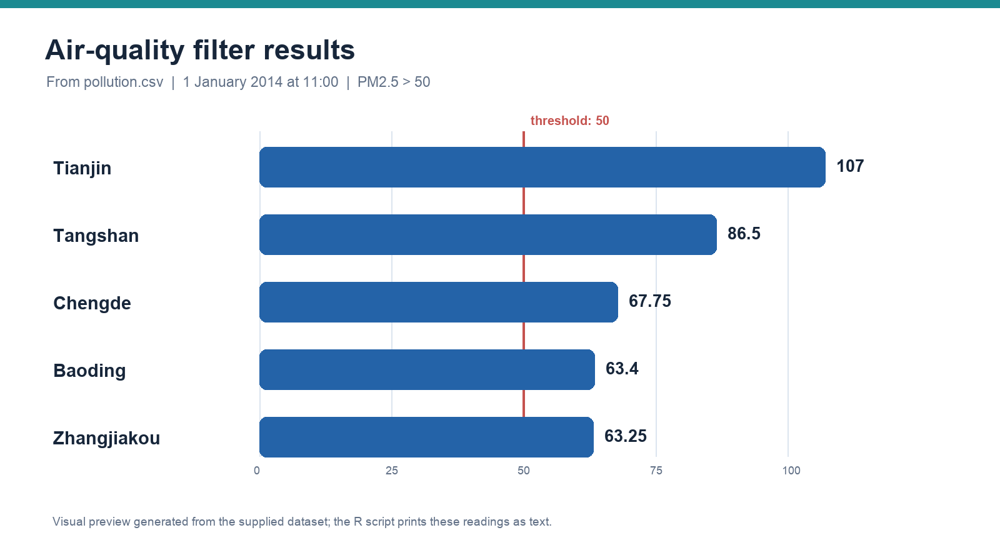

# Air-quality data analysis

[`air-quality.R`](air-quality.R) demonstrates two R techniques:

1. Generate 20 exponential random values with a fixed seed, count values above 1 using a loop, and check the count against R's vectorized `sum()`.
2. Read [`pollution.csv`](pollution.csv), select observations from 1 January 2014 at 11:00, and print city names and PM2.5 readings above 50.

The supplied CSV has 18,980 rows. For the specified date and time, the threshold query returns Tianjin, Tangshan, Baoding, Zhangjiakou, and Chengde.

Run from this folder with `Rscript air-quality.R` so the CSV is found in the working directory.

## What the script does in everyday terms

The file contains two small R examples. The first checks two ways of counting values. The second answers a specific question from an air-quality table: which locations have a PM2.5 value above 50 at the selected date and time?

### Part 1: a reproducible counting example

A fixed random seed makes the generated sample repeatable. The script creates 20 values from an exponential distribution, counts how many are above 1 using a loop, and checks that the result matches R's shorter, vectorized expression. This is a simple way to verify that the loop behaves as intended.

### Part 2: filtering the air-quality data

The script reads the CSV, selects 1 January 2014 at 11:00, filters those rows to PM2.5 values above 50, and prints the matching city names and readings.

**How to read the preview:** the displayed results are the locations returned by that exact filter. They describe one selected time, not each city's usual air quality. The threshold is the value used by the script; it is not presented as a verified health-standard classification.

### What makes this challenging

**Difficulty: introductory R sample.** The main things to get right are the column names, date/time representation, logical conditions, and working directory used to find the CSV. The loop-versus-vectorized check also demonstrates a useful habit: verify a result in a second way.

### What this sample demonstrates

Basic R syntax, reproducible random generation, reading a CSV, logical row filtering, and checking a computation. A larger analysis could add missing-data checks, trends over time, comparisons between locations, and documentation of the data source and units.
