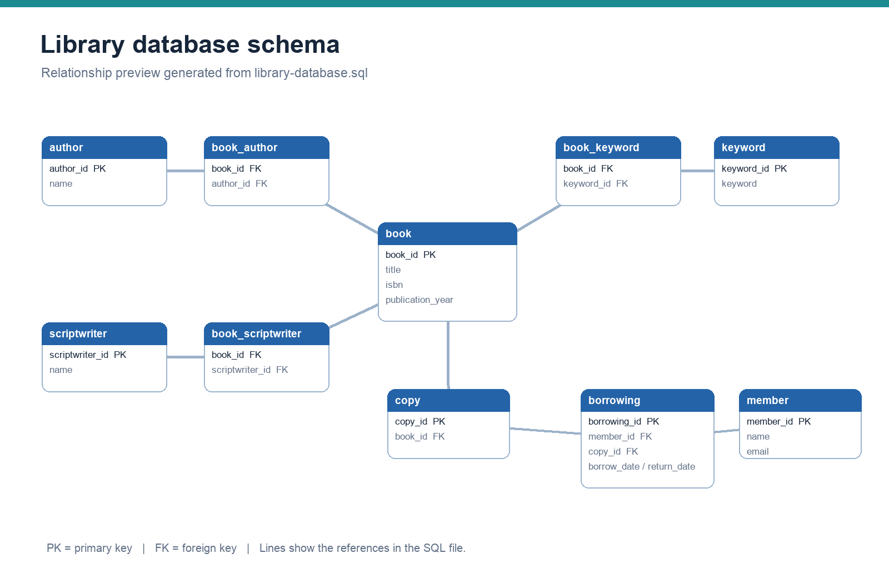

# Library database schema

[`library-database.sql`](library-database.sql) defines a PostgreSQL-style library database with ten tables: books, authors, scriptwriters, book copies, members, borrowings, keywords, and junction tables for many-to-many relationships.

The script demonstrates primary keys and foreign keys. It does not include sample records, analysis queries, or reports.

To run it, create the `library_database` database using the first statement, connect to that database, then run the `CREATE TABLE` statements. `CREATE DATABASE` does not automatically change the active connection.

## What the database represents

Imagine a library that owns several copies of the same book. The book title and publication details belong in one table, while each physical copy needs its own record. A borrowing then connects a member to one particular copy.

### Reading the diagram

- **Books, authors, and scriptwriters:** store the main descriptive records.
- **Link tables:** connect a book to multiple authors, scriptwriters, or keywords without repeating the full book record.
- **Copies:** distinguish individual physical copies of a book.
- **Members and borrowings:** identify who borrowed a copy and the recorded borrowing and return dates.

A primary key identifies a record. A foreign key connects it to another table and helps prevent references to records that do not exist.

### What makes this challenging

**Difficulty: introductory to intermediate database design.** The main design decision is deciding which things deserve separate tables and how they relate. The distinction between a book and a physical copy matters: without it, two people borrowing different copies of the same title would be difficult to represent correctly.

### Current scope and next steps

This file demonstrates table structure and relationships. It does not yet include sample data or SQL analysis queries. Useful additions would include duplicate-prevention constraints on link tables, required-field checks, borrowing-date validation, example records, and queries such as currently borrowed copies or the most borrowed books. Those additions would make it a more complete database project.
